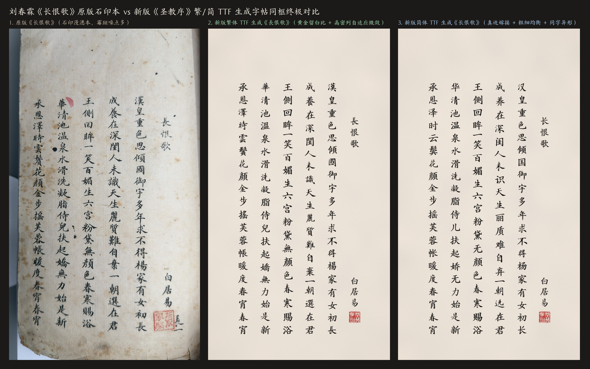
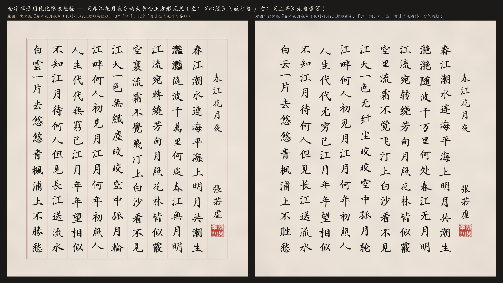
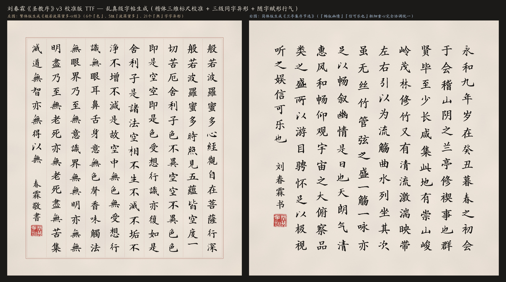
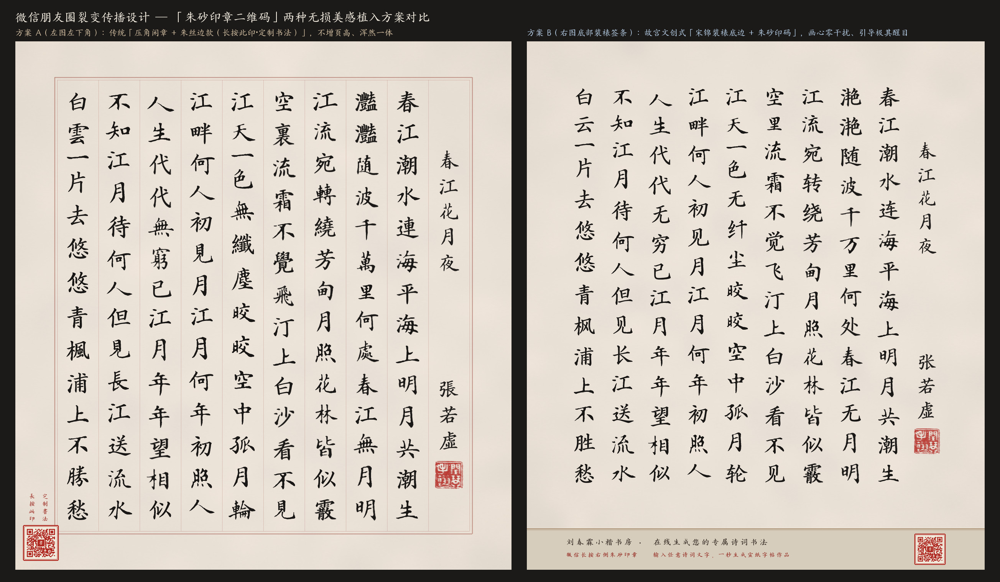
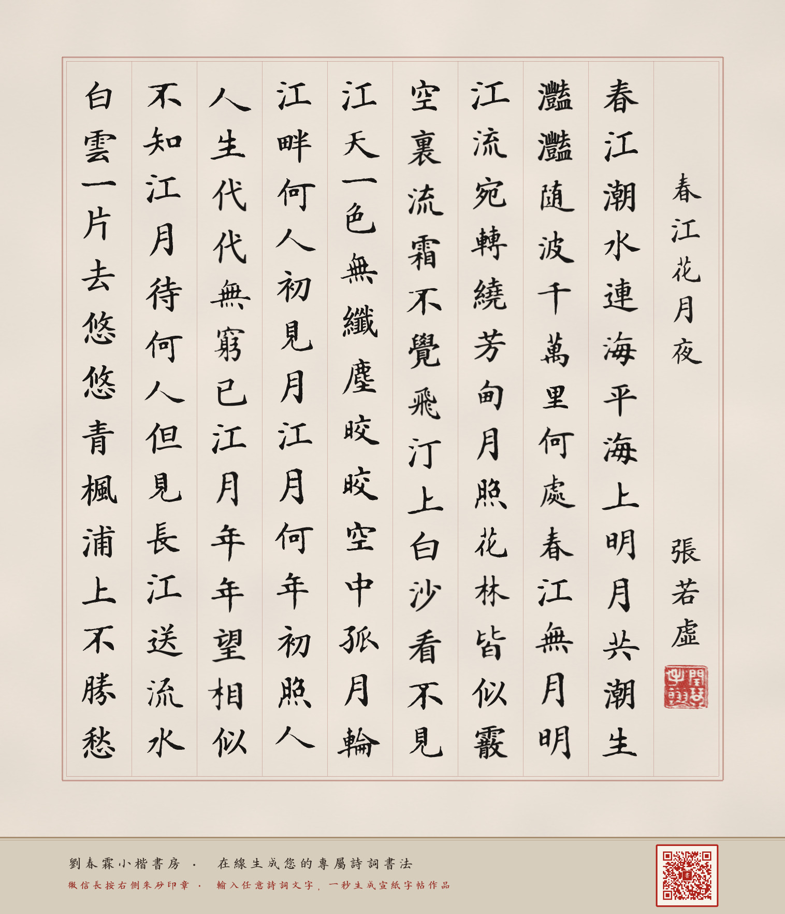
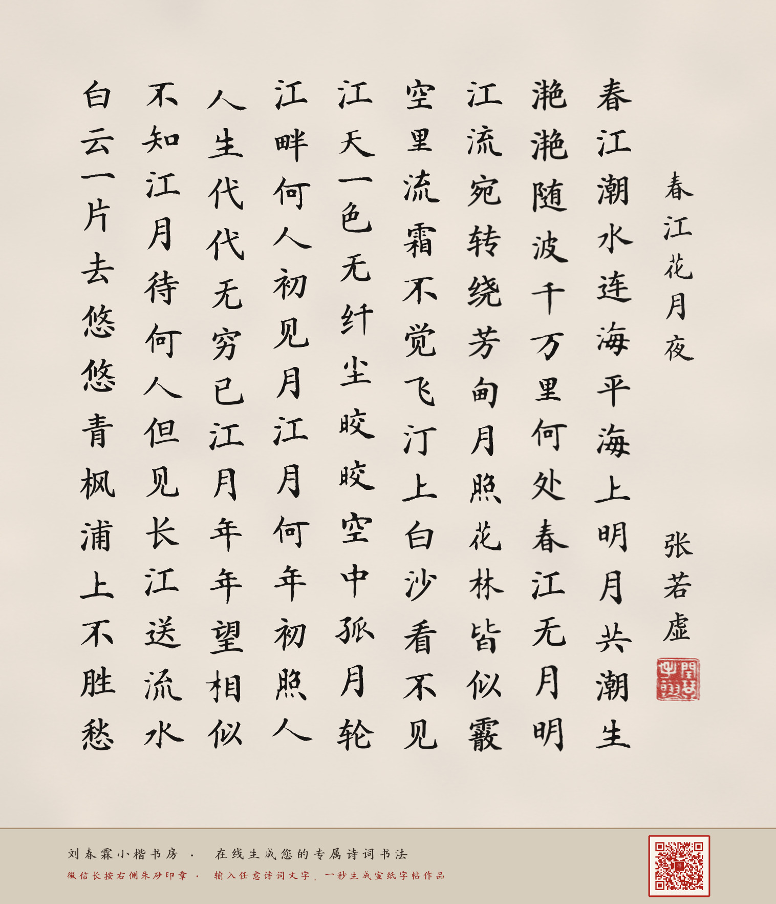
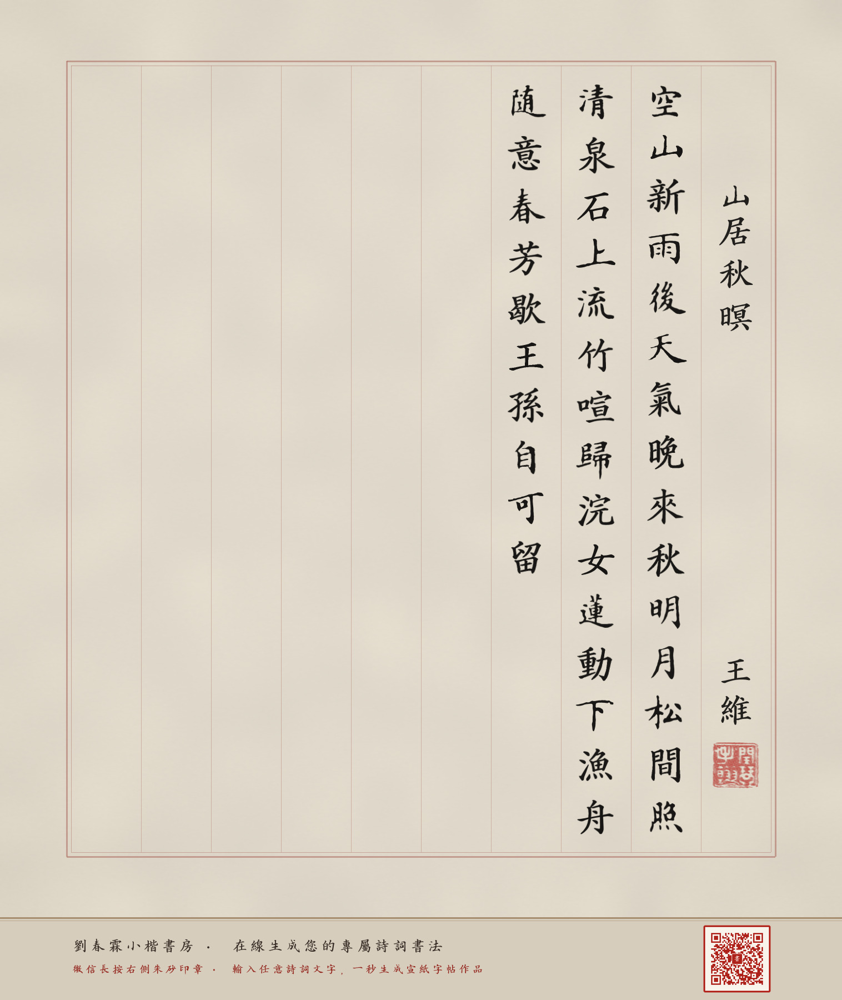
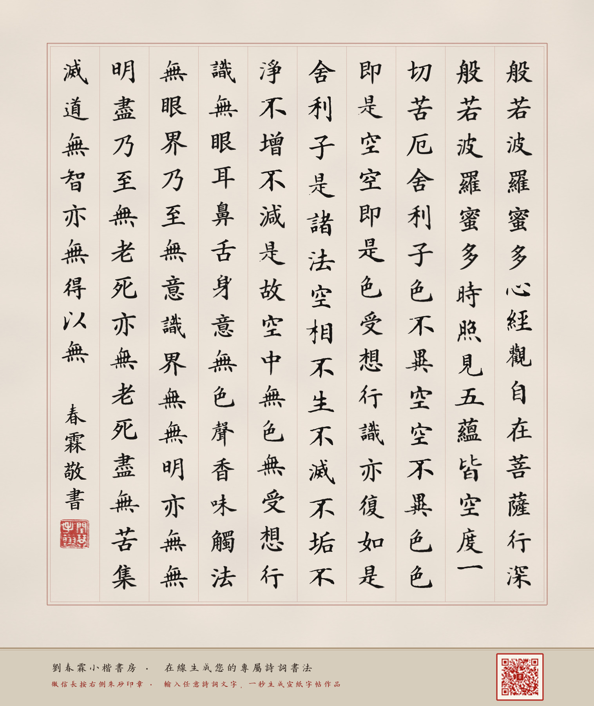
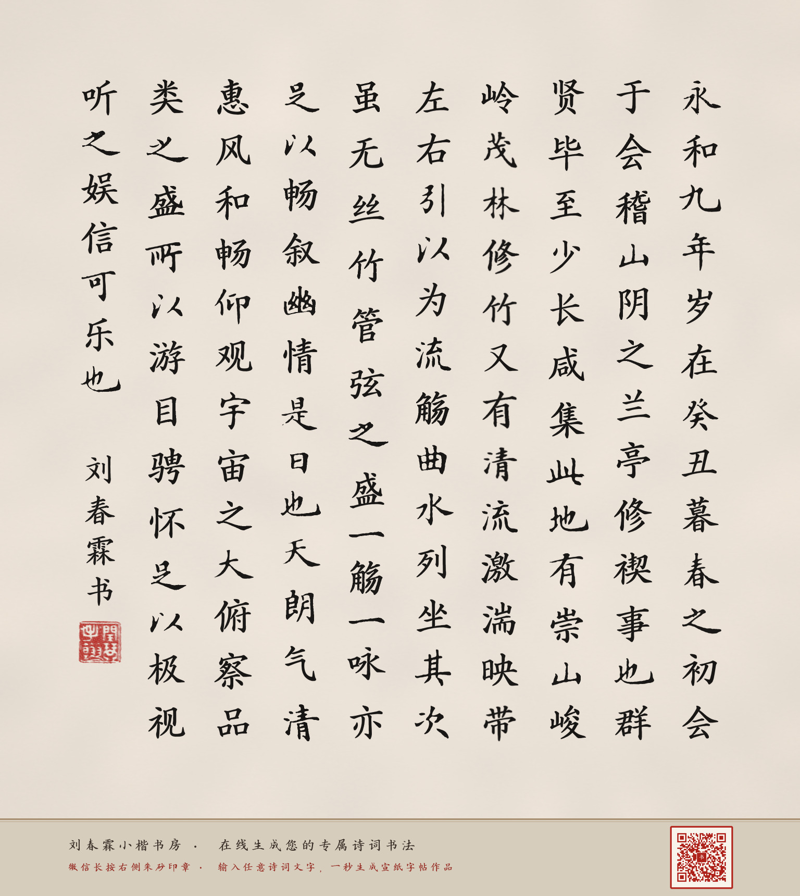

# 刘春霖 AI 小楷书房 · 在线诗词书法生成系统

> **由于合规原因，如需输入自定义文字，请联系邮箱 `sdicfund@hotmail.com`**
>
> 🌐 **在线体验网站（GitHub Pages 点开即用）**：**[https://dvbs2000.github.io/liuchunlin-shufa/](https://dvbs2000.github.io/liuchunlin-shufa/)**

---

## 一、核心亮点

1. **状元小楷 · 宣纸真迹神韵（`v003` 黄金版引擎）**：
   - 基于中国历史上最后一位状元**刘春霖（1872—1944）**传世小楷真迹研发，支持**繁体正统馆阁体**与**简体现代通用馆阁体**双字库。
   - 内置**三层动态书法异形引擎（同字异形 PUA 轮换 + 部件级错落微变 + 弹性笔势场与蘸墨呼吸）**与**随字赋形不等距纵向排版（True Bounding-Box Vertical Kerning）**，彻底消除电脑排字机械感。
2. **智能题名 / 作者 / 诗词体裁识别**：
   - 粘贴任意诗词或文章（支持首行直接带 `《题名》` 与作者），系统自动识别体裁：
     - **七言古近体诗**：自动采用 **10列×14行** 正方形册页，右侧第 1 列独立低三格排题名 + 作者落款 + 齐脚朱文印，正文每列恰好一联 14 字（单页容量 126 字）。
     - **五言古近体诗**：自动采用 **10列×15行** 正方形册页，右侧第 1 列独立题名落款，正文每列恰好三句 15 字（单页容量 135 字）。
     - **散文 / 经文**：自动顶格起写，于第 10 列篇尾自动落款钤印（单页容量 124~144 字）。
   - 超出单页字数时自动截取第一页容量排版，绝不报错。
3. **故宫文创式宋锦装裱签条 + 微信长按识别朱砂印章二维码**：
   - 每幅生成作品底部自动装裱故宫宋锦底边与「朱砂印章式二维码」，手机微信长按图片即可直接识别二维码进入 **[刘春霖 AI 小楷书房](https://dvbs2000.github.io/liuchunlin-shufa/)** 创作自己的专属诗词书法。

---

## 二、真迹对比与名篇书法作品馆

### 1. 《长恨歌》宣纸真迹 vs AI 小楷复刻对比

---

### 2. 《春江花月夜》繁简双绝 · 零训练盲测全景图

---

### 3. 《般若波罗蜜多心经》乌丝栏 &《兰亭集序》无格素笺双范式

---

### 4. 微信朋友圈裂变装裱设计（故宫宋锦装裱底边 + 朱砂印章二维码）

---

## 三、在线实时生成单页作品样张（长按右下角朱砂印章可直接扫码体验）

| 《春江花月夜》（繁体 · 乌丝栏带格 · 10×14） | 《春江花月夜》（简体 · 仿古无格素笺 · 10×14） |
| :---: | :---: |
|  |  |

| 《山居秋暝》（五言律诗 · 乌丝栏带格 · 10×15） | 《般若波罗蜜多心经》（繁体 · 乌丝栏带格 · 10×15） |
| :---: | :---: |
|  |  |

| 《兰亭集序》（简体 · 仿古无格素笺 · 10×13） | 交流与定制 |
| :---: | :---: |
|  | **在线体验**： [https://dvbs2000.github.io/liuchunlin-shufa/](https://dvbs2000.github.io/liuchunlin-shufa/)  **定制说明**： 由于合规原因，如需输入自定义文字，请联系邮箱 **`sdicfund@hotmail.com`** |
